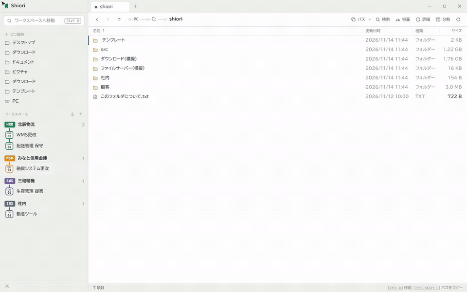
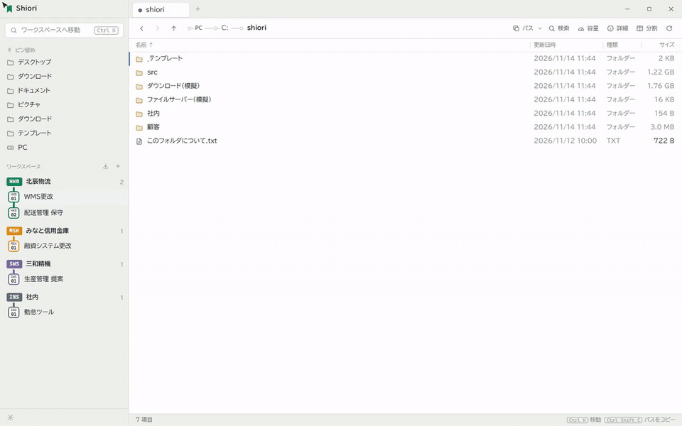
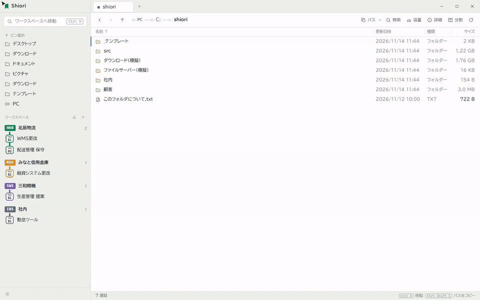
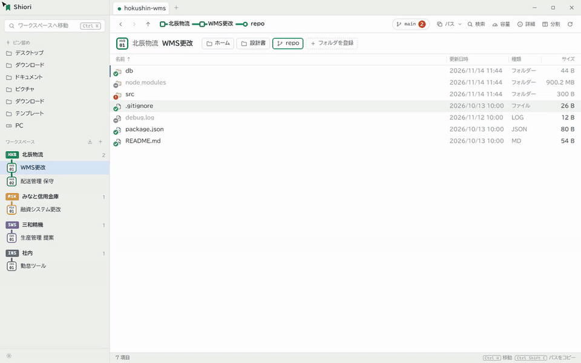
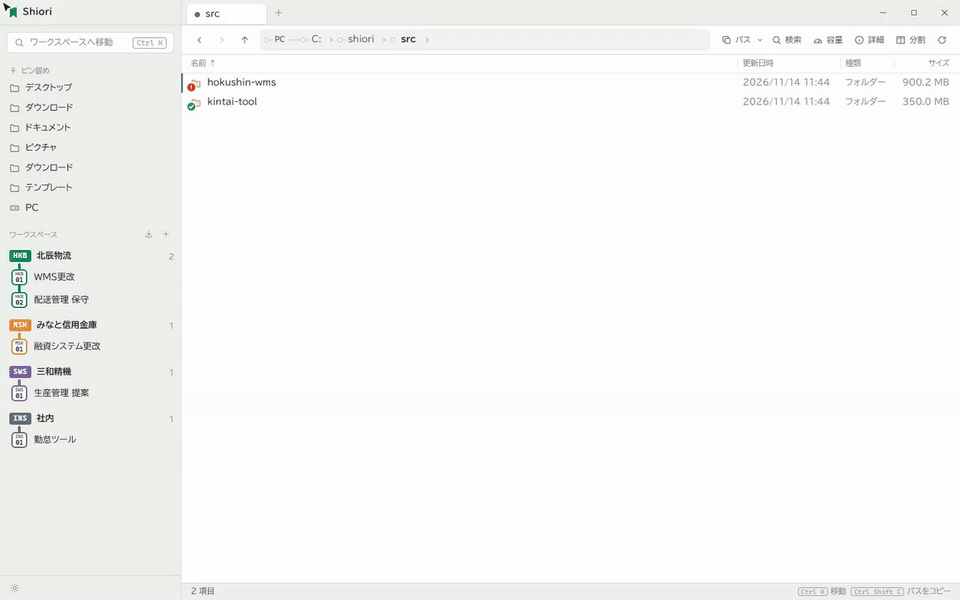
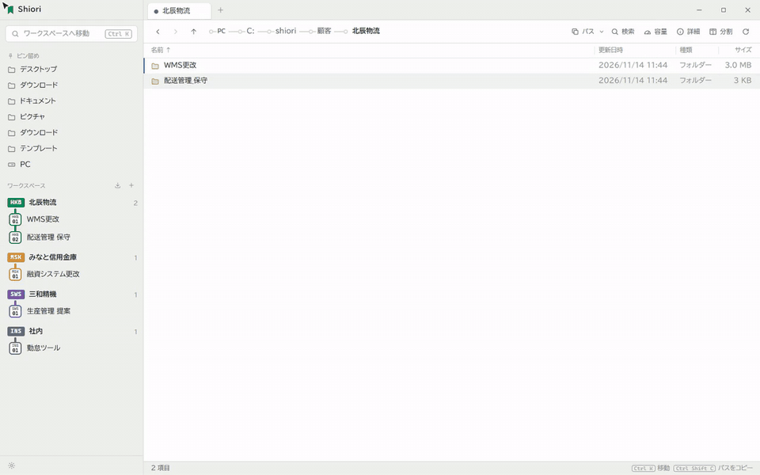

<p align="center">
  
</p>

<h1 align="center">Shiori 栞</h1>

<p align="center">
  <b>散らばった仕事のフォルダを、案件ごとにひとまとめ。</b><br>
  設計書はファイルサーバー、ソースは別のドライブ、受け取った資料はダウンロード——<br>
  あちこちにあるフォルダを案件ごとにまとめて、一瞬で開ける Windows 用のファイラーです。
</p>

<p align="center">
  <a href="https://shiori-filer.github.io/ShioriOfficial/download/Shiori_0.1.5_x64-setup.exe"><b>ダウンロード（v0.1.5）</b></a>
  ・
  <a href="https://shiori-filer.github.io/ShioriOfficial/">公式サイト</a>
  ・
  <a href="https://shiori-filer.github.io/ShioriOfficial/guide/">使い方ガイド</a>
  <br><sub>無料・Windows 10 / 11（64 ビット）・管理者の権限は不要</sub>
</p>

<p align="center">
  
</p>

## こんな毎日に

- 案件ごとに、**ファイルサーバーの設計書・手元のリポジトリ・届いた資料**を行き来している
- エクスプローラーを開き直すたびに、**同じ場所までフォルダをたどり直している**
- 「あの仕様、どの Excel に書いてあったっけ」と、**ファイルを 1 つずつ開いて探している**

Shiori は、こうした「ちょっと面倒」をまとめて片付けます。

## 特長

<table>
  <tr>
    <td width="50%" valign="top">
      <br>
      <b>案件ごとにまとめる「ワークスペース」</b><br>
      「顧客 › 案件 › 作業」のように入れ子にでき、共有フォルダ・別のドライブ・リポジトリなど、別々の場所のフォルダを 1 つに登録できます。<kbd>Ctrl</kbd>+<kbd>K</kbd> で、名前・よみ・ローマ字から一瞬で移動。
    </td>
    <td width="50%" valign="top">
      <br>
      <b>開いていたフォルダを、案件ごとに覚える</b><br>
      タブと左右の分割をワークスペースごとに保存。別の案件に切り替えても、戻ればさっきの続きから。アプリを閉じて開き直しても、そのままです。
    </td>
  </tr>
  <tr>
    <td width="50%" valign="top">
      <br>
      <b>ファイルの中身まで、すぐ見つかる</b><br>
      ファイル名は打つそばから。<kbd>Tab</kbd> で中身の検索に切り替わり、Excel・Word・PowerPoint・テキストの中まで探します。
    </td>
    <td width="50%" valign="top">
      <br>
      <b>開かずに、中身を確認</b><br>
      <kbd>Space</kbd> で Excel・Word・PowerPoint・画像・Markdown・ソースコードをその場で表示。<kbd>↑</kbd> <kbd>↓</kbd> で次のファイルへ。
    </td>
  </tr>
  <tr>
    <td width="50%" valign="top">
      <br>
      <b>Git の状態とログ</b><br>
      ブランチ名と変更の数がパスの横に。押せば変更したファイルへすぐ移れます。ログはグラフつきで、ファイルの差分は左右に並べて比べられます。
    </td>
    <td width="50%" valign="top">
      <br>
      <b>フォルダ構成ごとのテンプレート</b><br>
      「01_要件定義」「02_基本設計」…といった案件フォルダのひな形を、名前を付けるだけで作れます。
    </td>
  </tr>
</table>

ほかにも、ZIP・7z の中をそのまま開く、<kbd>Ctrl</kbd>+<kbd>Z</kbd> でごみ箱に入れた削除も元に戻す、OneDrive をアカウントごとに一覧、空き容量のチェック、右クリックに 7-Zip や TortoiseGit を直接並べる、画面共有のときにワークスペースの一覧を隠す（<kbd>Ctrl</kbd>+<kbd>B</kbd>）、4 つの配色など。
すべての機能は[使い方ガイド](https://shiori-filer.github.io/ShioriOfficial/guide/)（写真つき）で紹介しています。

## エクスプローラーと比べると

いつものエクスプローラーはそのまま使えます。Shiori は、案件ごとに仕事をするときに足りないところを補います。

| | Shiori | エクスプローラー |
|---|:---:|:---:|
| 案件ごとにフォルダをまとめる | ✅ ワークスペース（入れ子にできる） | △ クイックアクセスにピン留め |
| 別々の場所のフォルダを 1 か所に | ✅ | — |
| 開いていたタブを案件ごとに覚える | ✅ | — |
| 左右 2 画面 | ✅ | — |
| ファイルの中身で検索 | ✅ Excel・Word・PowerPoint の中も | △ インデックスのある場所が中心 |
| 開かずに中身を見る | ✅ <kbd>Space</kbd> で次々に | △ プレビュー ウィンドウ |
| Git のブランチ・変更・ログ | ✅ | — |
| フォルダ構成ごとのテンプレート | ✅ | — |

## よく使うキー

| キー | できること |
|---|---|
| <kbd>Ctrl</kbd>+<kbd>K</kbd> | ワークスペースへ移動 |
| <kbd>Ctrl</kbd>+<kbd>L</kbd> | アドレス欄に入力（パス・ワークスペース・ファイル名・操作） |
| <kbd>Ctrl</kbd>+<kbd>F</kbd> | 検索（<kbd>Tab</kbd> でファイルの中身） |
| <kbd>Space</kbd> | プレビュー |
| <kbd>Ctrl</kbd>+<kbd>\\</kbd> | 左右に分割 / 戻す |
| <kbd>Ctrl</kbd>+<kbd>Shift</kbd>+<kbd>P</kbd> | コマンドパレット（操作を名前で探す） |
| <kbd>F1</kbd> | 使い方ガイド |

すべてのキーは、アプリの「Shiori について」（サイドバーの下の ⓘ）で一覧できます。

## インストール

1. [Shiori_0.1.5_x64-setup.exe](https://shiori-filer.github.io/ShioriOfficial/download/Shiori_0.1.5_x64-setup.exe) をダウンロードして実行します。
2. 使用許諾契約に同意すると、インストールが始まります。管理者の権限は要りません（今のユーザーにだけインストールされます）。
3. 新しいバージョンが出ると、起動したときに画面の上に知らせが出ます。「今すぐ更新」を押すと、そのまま更新して開き直します。

> [!NOTE]
> インストーラーにはまだデジタル署名をしていないため、初めて実行すると「Windows によって PC が保護されました」と表示されることがあります。
> その場合は「詳細情報」→「実行」を選んでください。

**動作環境:** Windows 10 / 11（64 ビット）。Microsoft Edge WebView2 ランタイムを使います（Windows 11 には最初から入っています。入っていない場合はインストール中に自動で入ります）。

**あると便利なもの（なくても動きます）:**

- [Git](https://git-scm.com/): ブランチ・変更・ログの表示
- [7-Zip](https://7-zip.org/): 7z・rar などの中を見る（ZIP は 7-Zip がなくても開けます）
- [WinMerge](https://winmerge.org/): ファイル・フォルダの比較

<details>
<summary><b>アンインストール</b></summary>

Windows の「設定」→「アプリ」→「インストールされているアプリ」から Shiori をアンインストールします。
設定とワークスペースも消したいときは、次のフォルダを削除してください。

```
%APPDATA%\jp.shiori.app\        ワークスペース・設定（workspaces.toml、settings.toml）
%LOCALAPPDATA%\jp.shiori.app\   開いていたタブ・画面の配置
```

ワークスペースから外しても、アンインストールしても、登録していたフォルダそのものが消えることはありません。

</details>

## ライセンス

Shiori は無料で使えます。個人・法人を問わず、業務にも使えます。会社の中でインストーラーを配ることもできます。
ただし、インストーラーをインターネットなど組織の外へ再配布することと、改変・リバースエンジニアリングは禁止しています。紹介するときは、[公式サイト](https://shiori-filer.github.io/ShioriOfficial/)へのリンクをお使いください。

- 条件の全文: [LICENSE](LICENSE)（[利用規約](https://shiori-filer.github.io/ShioriOfficial/terms.html)と同じ内容です）
- Shiori のソースコードは公開していません。
- Shiori が使っているオープンソースソフトウェアのライセンスは、アプリの「Shiori について」（サイドバーの下の ⓘ）で確認できます。

## プライバシー

Shiori がインターネットに接続するのは、新しいバージョンの確認と更新のときだけです（起動時の確認は「設定 → 更新」でオフにできます）。ファイルやフォルダ、ワークスペースの情報は送りません。設定もワークスペースも、すべてパソコンの中だけに保存します。
詳しくは[プライバシーポリシー](https://shiori-filer.github.io/ShioriOfficial/privacy.html)をご覧ください。

## 不具合の報告・ご質問

[Issues](https://github.com/shiori-filer/ShioriOfficial/issues) へお寄せください。Windows のバージョンと、どの操作で起きたかを書いていただけると助かります。
Issues は誰でも見られるため、個人情報や社内の情報（実際のフォルダ名・ファイル名など）は書かないでください。

<details>
<summary><b>このリポジトリについて</b></summary>

公式サイト（GitHub Pages）とインストーラーを置いています。`main` に push すると、数分でサイトに反映されます。

| 場所 | 中身 |
|---|---|
| `index.html`、`terms.html`、`privacy.html`、`style.css`、`*.js` | 公式サイト |
| `guide/` | 使い方ガイド（アプリの F1 で開くものと同じ） |
| `media/` | サイトの動画と画像（デモ用の架空のデータで撮影しています） |
| `media/readme/` | この README のアニメーション |
| `download/` | インストーラー |

</details>

---

<p align="center"><sub>© 2026 Shiori</sub></p>
