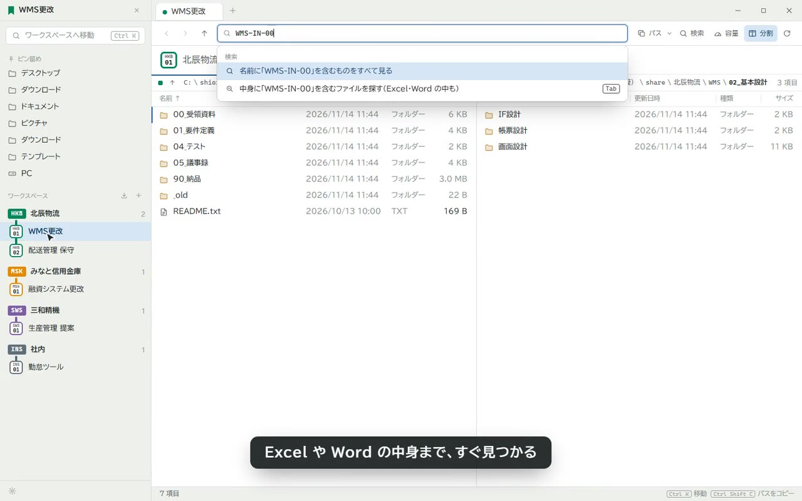
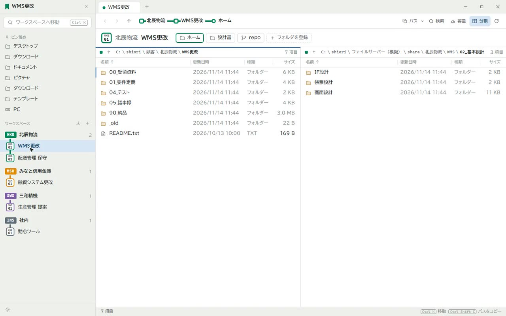
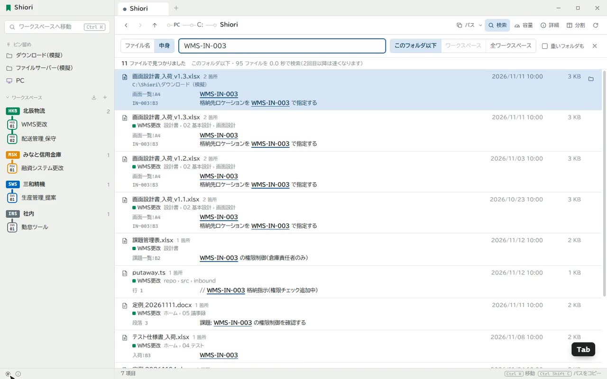

<p align="center">
  
</p>

<h1 align="center">Shiori 栞</h1>

<p align="center">
  散らばった仕事のフォルダを、案件ごとにひとまとめ。<br>
  Windows 10 / 11 用のファイラーです。
</p>

<p align="center">
  <a href="https://shiori-filer.github.io/ShioriOfficial/"><b>公式サイト</b></a>
  ・
  <a href="https://shiori-filer.github.io/ShioriOfficial/download/Shiori_0.1.1_x64-setup.exe"><b>ダウンロード（v0.1.1）</b></a>
</p>

<p align="center">
  
</p>

設計書はファイルサーバー、ソースは別のドライブ、受け取った資料はダウンロード。
Shiori は、ひとつの案件のフォルダを「ワークスペース」にまとめて、いつでも一瞬で開けるファイラーです。

## できること

| | |
|---|---|
| **ワークスペースを階層で管理** | 「顧客 › 案件 › 作業」のように自由に入れ子にでき、別々の場所にあるフォルダ（共有フォルダ、ローカルの repo など）をひとつのワークスペースに登録できます。Ctrl+K で、名前やよみ・ローマ字から移動。 |
| **開いていたフォルダを覚える** | タブと左右の分割を、ワークスペースごとに保存します。アプリを閉じて開き直しても、そのままです。 |
| **Git の状態** | リポジトリを開くと、ブランチ名と、今開いているフォルダの中の変更の数がパスの横に出ます。 |
| **右クリックのカスタマイズ** | 7-Zip や TortoiseGit など、Windows の右クリックメニューのよく使う項目だけを、「その他のオプションを確認」を開かずに使えます。 |
| **速い検索、ファイルの中身まで** | ファイル名は打つそばから見つかります。Tab で中身の検索に切り替わり、Excel・Word・PowerPoint・テキストの中まで探せます。 |
| **空き容量のチェック** | ドライブの空きと、どのフォルダが場所を取っているかを大きい順に表示します。 |
| **プレビュー** | Space キーで Excel・Word・PowerPoint・画像・Markdown・ソースコードをその場で表示します。 |
| **フォルダごとのテンプレート** | 「01_要件定義」「02_基本設計」…といった案件フォルダのひな形を、フォルダ構成ごとテンプレートにできます。 |

ほかにも、ZIP・7z の中をそのまま開く、Ctrl+Z でごみ箱に入れた削除も元に戻す、OneDrive の同期状態の表示、WinMerge での比較、4 つの配色など。
詳しくは[公式サイト](https://shiori-filer.github.io/ShioriOfficial/)の動画をご覧ください。

<p>
  
  
</p>

## インストール

1. [Shiori_0.1.1_x64-setup.exe](https://shiori-filer.github.io/ShioriOfficial/download/Shiori_0.1.1_x64-setup.exe) をダウンロードして実行します。
2. 使用許諾契約に同意すると、インストールが始まります。管理者の権限は要りません（今のユーザーにだけインストールされます）。
3. 新しいバージョンが出ると、起動したときに画面の上に知らせが出ます。「今すぐ更新」を押すと、そのまま更新して開き直します。

> [!NOTE]
> インストーラーにはまだデジタル署名をしていないため、初めて実行すると「Windows によって PC が保護されました」と表示されることがあります。
> その場合は「詳細情報」→「実行」を選んでください。

**動作環境:** Windows 10 / 11（64 ビット）。Microsoft Edge WebView2 ランタイムを使います（Windows 11 には最初から入っています。入っていない場合はインストール中に自動で入ります）。

**あると便利なもの（なくても動きます）:**

- [Git](https://git-scm.com/): ブランチと変更の表示
- [7-Zip](https://7-zip.org/): 7z・rar などの中を見る（ZIP は 7-Zip がなくても開けます）
- [WinMerge](https://winmerge.org/): ファイル・フォルダの比較

### アンインストール

Windows の「設定」→「アプリ」→「インストールされているアプリ」から Shiori をアンインストールします。
設定とワークスペースも消したいときは、次のフォルダを削除してください。

```
%APPDATA%\jp.shiori.app\        ワークスペース・設定（workspaces.toml、settings.toml）
%LOCALAPPDATA%\jp.shiori.app\   開いていたタブ・画面の配置
```

ワークスペースから外しても、アンインストールしても、登録していたフォルダそのものが消えることはありません。

## ライセンス

Shiori は無料で使えます。個人・法人を問わず、業務にも使えます。会社の中でインストーラーを配ることもできます。
ただし、インストーラーをインターネットなど組織の外へ再配布することと、改変・リバースエンジニアリングは禁止しています。紹介するときは、[公式サイト](https://shiori-filer.github.io/ShioriOfficial/)へのリンクをお使いください。

- 条件の全文: [LICENSE](LICENSE)（[利用規約](https://shiori-filer.github.io/ShioriOfficial/terms.html)と同じ内容です）
- Shiori のソースコードは公開していません。
- Shiori が使っているオープンソースソフトウェアのライセンスは、アプリの「Shiori について」（サイドバーの下の ⓘ）で確認できます。

## プライバシー

Shiori がインターネットに接続するのは、新しいバージョンの確認と更新のときだけです（起動時の確認は「設定 → 更新」でオフにできます）。ファイルやフォルダ、ワークスペースの情報は送りません。設定もワークスペースも、すべてパソコンの中だけに保存します。
詳しくは[プライバシーポリシー](https://shiori-filer.github.io/ShioriOfficial/privacy.html)をご覧ください。

## 不具合の報告・ご質問

[Issues](https://github.com/shiori-filer/ShioriOfficial/issues) へお寄せください。Windows のバージョンと、どの操作で起きたかを書いていただけると助かります。
Issues は誰でも見られるため、個人情報や社内の情報（実際のフォルダ名・ファイル名など）は書かないでください。

## このリポジトリについて

公式サイト（GitHub Pages）とインストーラーを置いています。`main` に push すると、数分でサイトに反映されます。

| 場所 | 中身 |
|---|---|
| `index.html`、`terms.html`、`privacy.html`、`style.css`、`*.js` | 公式サイト |
| `media/` | サイトの動画と画像（デモ用の架空のデータで撮影しています） |
| `download/` | インストーラー |

---

© 2026 Shiori
